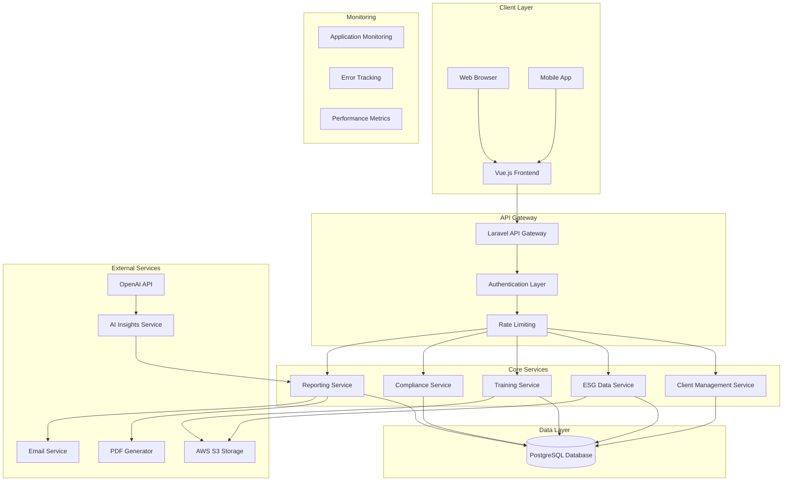
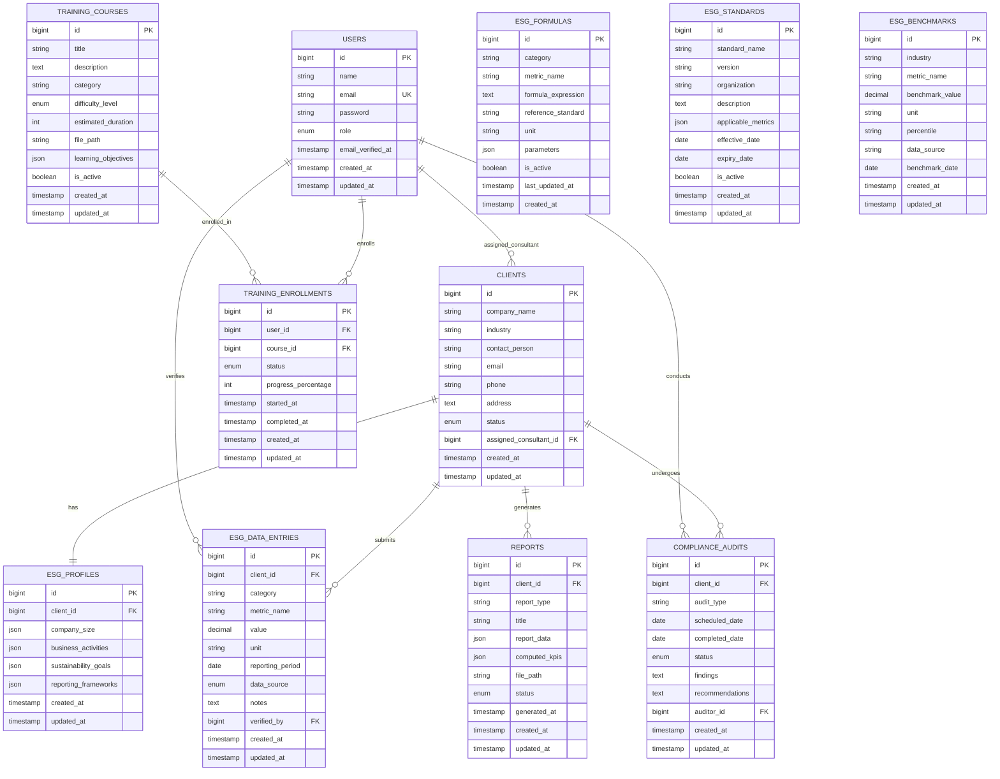
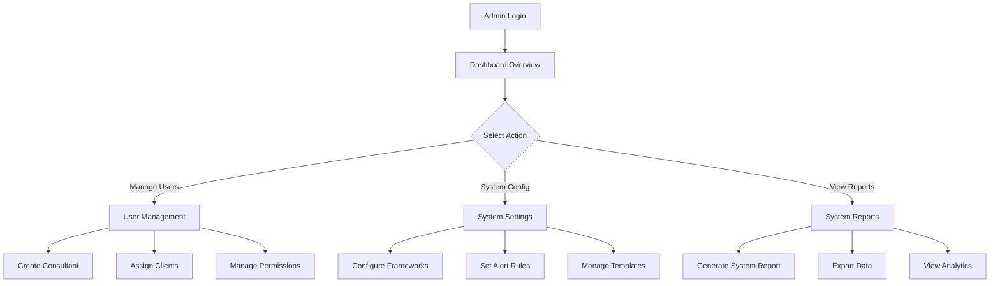
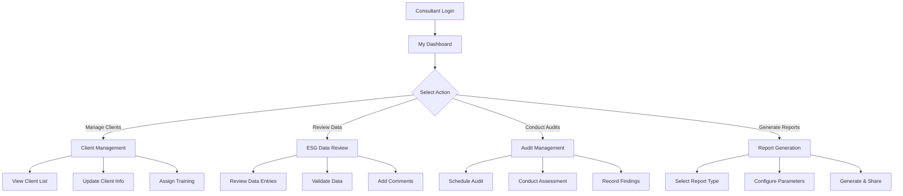
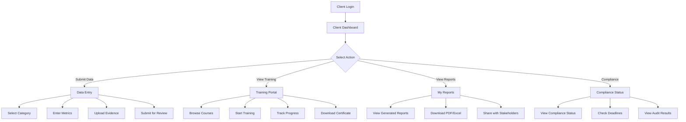
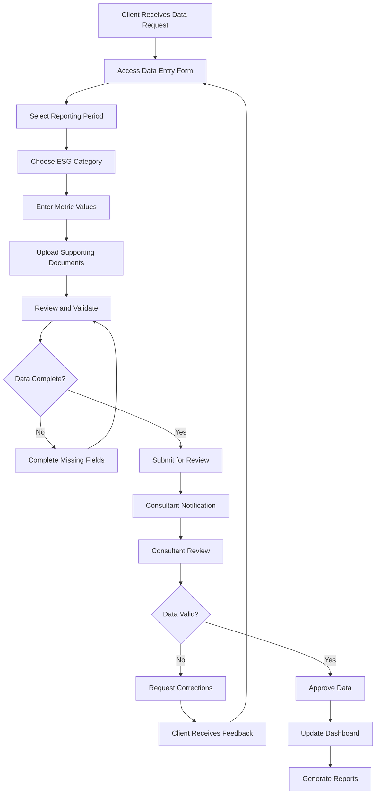

# ESG Consulting Management Platform
## Complete System Architecture & Documentation

### Table of Contents
1. [System Overview](#system-overview)
2. [System Architecture](#system-architecture)
3. [Database Schema](#database-schema)
4. [Core Modules](#core-modules)
5. [API Endpoints](#api-endpoints)
6. [User Flows](#user-flows)
7. [Implementation Plan](#implementation-plan)
8. [Project Structure](#project-structure)
9. [Future Expansion](#future-expansion)

---

## System Overview

The ESG Consulting Management Platform is a comprehensive system designed to support ESG consulting firms in managing client relationships, tracking ESG data, providing training, and ensuring compliance. The platform serves both internal consultants and external client companies.

### Key Features
- **Client Management**: Complete client lifecycle management
- **ESG Data Tracking**: Multi-framework data collection and analysis
- **Training Management**: Learning management system with certification
- **Compliance Monitoring**: Automated alerts and audit management
- **Reporting & Analytics**: Comprehensive ESG performance dashboards
- **AI Insights**: ESG risk scoring and recommendations (Phase 2)

### Technology Stack
- **Frontend**: Vue.js 3 with Composition API
- **Backend**: Laravel 10 with API resources
- **Database**: PostgreSQL 15
- **Authentication**: Laravel Sanctum with role-based access
- **Visualization**: Chart.js with D3.js for advanced charts
- **File Storage**: AWS S3 or Laravel Storage
- **Deployment**: Docker with AWS ECS or Render
- **AI Integration**: OpenAI API for insights generation

---

## System Architecture



### Architecture Components

#### 1. Frontend Layer (Vue.js)
- **Dashboard**: Real-time ESG metrics and KPIs
- **Data Entry**: Forms for ESG data collection
- **Training Portal**: Course management and progress tracking
- **Reporting Interface**: Custom report generation
- **Admin Panel**: System configuration and user management

#### 2. API Gateway (Laravel)
- **Authentication**: JWT tokens with role-based permissions
- **Rate Limiting**: API throttling and abuse prevention
- **Request Validation**: Input sanitization and validation
- **Response Formatting**: Consistent JSON API responses

#### 3. Core Services
- **Client Management**: CRUD operations for clients and projects
- **ESG Data Service**: Data collection, validation, and storage
- **Training Service**: Course management and progress tracking
- **Compliance Service**: Audit scheduling and alert management
- **Reporting Service**: Report generation and data visualization

#### 4. Data Layer
- **Primary Database**: PostgreSQL for transactional data
- **File Storage**: AWS S3 for documents and media
- **Cache Layer**: Redis for session management and caching
- **Search Engine**: Elasticsearch for advanced data queries

---

## Database Schema

### Entity Relationship Diagram



### Database Tables Description

#### Core Tables

**users**
- Stores system users (admins, consultants, clients)
- Role-based access control
- Email verification and password management

**clients**
- Company information and contact details
- Assignment to specific consultants
- Status tracking (active, inactive, suspended)

**esg_profiles**
- Client-specific ESG configuration
- Reporting framework preferences
- Sustainability goals and targets

**esg_data_entries**
- Individual ESG metrics and measurements
- Time-series data with validation
- Source tracking and verification

**training_courses**
- Course catalog with metadata
- File storage for training materials
- Learning objectives and difficulty levels

**training_enrollments**
- User progress tracking
- Completion status and certificates
- Time tracking for compliance

**compliance_audits**
- Audit scheduling and management
- Findings and recommendations
- Auditor assignment and tracking

**reports**
- Generated reports and analytics
- Computed ESG KPIs and calculations
- File storage for PDF/Excel exports
- Report metadata and status

**esg_formulas**
- ESG calculation formulas and expressions
- Reference standards and methodologies
- Formula parameters and validation rules
- Version control for formula updates

**esg_standards**
- International standards and frameworks
- Version tracking and effective dates
- Applicable metrics and requirements
- Compliance mapping and updates

**esg_benchmarks**
- Industry benchmark data
- Performance percentiles and comparisons
- Data sources and reliability indicators
- Historical benchmark tracking

---

## Core Modules

### 1. Client Management System (CMS)

#### Purpose
Manage client relationships, project assignments, and consultant allocation.

#### Data Inputs
- Company information (name, industry, contact details)
- ESG profile configuration
- Consultant assignments
- Project timelines and milestones

#### Data Outputs
- Client dashboard with project status
- Consultant workload reports
- Client communication history
- Project progress tracking

#### Key Features
- Client onboarding workflow
- Consultant assignment and workload management
- Project milestone tracking
- Communication log management

#### Module Interactions
- **ESG Data Tracker**: Provides client context for data collection
- **Training Module**: Manages client training requirements
- **Compliance Module**: Schedules audits and compliance checks
- **Reporting Module**: Generates client-specific reports

### 2. ESG Data Tracker

#### Purpose
Collect, validate, and store ESG performance data from clients with automated computation of key performance indicators using standardized formulas and international frameworks.

#### Data Inputs
- Environmental metrics (energy, water, waste, emissions)
- Social metrics (employee satisfaction, diversity, safety)
- Governance metrics (board composition, ethics, transparency)
- Supporting documentation and evidence
- Activity data for emission calculations
- Production and revenue data for intensity calculations

#### Data Outputs
- Validated ESG datasets
- Computed ESG KPIs using standardized formulas
- Data quality reports
- Trend analysis and benchmarking
- Compliance status indicators
- Industry benchmark comparisons

#### Key Features
- Multi-framework data collection (GRI, ISO, SDGs, TCFD)
- Automated ESG KPI computation using standardized formulas
- Data validation and quality checks
- Time-series analysis and trending
- Benchmarking against industry standards
- Real-time formula validation and error detection

#### ESG Computation Formulas

##### Environmental Indicators

**Carbon Emission (CO₂e)**
```
Formula: Σ(Activity Data × Emission Factor)
Reference: IPCC Guidelines (2006)
Unit: tonnes CO₂e
Implementation: Dynamic calculation based on activity data and emission factors
```

**Energy Intensity**
```
Formula: Total Energy Consumed (kWh) / Revenue (USD)
Reference: GRI 302-3
Unit: kWh/USD
Implementation: Automated calculation with revenue data integration
```

**Water Intensity**
```
Formula: Total Water Withdrawn (m³) / Production Output (tons)
Reference: GRI 303-5
Unit: m³/ton
Implementation: Production data integration for accurate calculations
```

**Waste Recycling Rate**
```
Formula: (Recycled Waste / Total Waste Generated) × 100
Reference: ISO 14001, GRI 306
Unit: Percentage (%)
Implementation: Waste tracking with automated percentage calculation
```

**Air Quality Index (AQI)**
```
Formula: Function(PM₂.₅, PM₁₀, NO₂, SO₂, CO, O₃)
Reference: WHO Air Quality Guidelines
Unit: AQI Score
Implementation: Multi-pollutant calculation with health impact assessment
```

##### Social Indicators

**Employee Turnover Rate**
```
Formula: (Employees Leaving / Average Employees) × 100
Reference: GRI 401-1
Unit: Percentage (%)
Implementation: HR data integration with quarterly/annual calculations
```

**Diversity Ratio**
```
Formula: (Female Employees / Total Employees) × 100
Reference: GRI 405
Unit: Percentage (%)
Implementation: Demographic data analysis with intersectional metrics
```

**Training Hours per Employee**
```
Formula: Total Training Hours / Total Employees
Reference: ISO 30414, GRI 404
Unit: Hours per employee
Implementation: Training data aggregation with employee count normalization
```

##### Governance Indicators

**Board Independence**
```
Formula: (Independent Directors / Total Directors) × 100
Reference: GRI 102-22
Unit: Percentage (%)
Implementation: Board composition analysis with independence verification
```

**Ethics Compliance Index**
```
Formula: Weighted score based on ethics trainings, violations, and whistle-blower cases
Reference: ISO 37001 (Anti-Bribery Management)
Unit: Index Score (0-100)
Implementation: Multi-factor scoring with weighted components
```

#### Referenced Frameworks & Standards

##### Global Reporting Initiative (GRI)
- **GRI 302**: Energy consumption and intensity metrics
- **GRI 303**: Water withdrawal and consumption tracking
- **GRI 306**: Waste generation and management
- **GRI 401**: Employment and labour practices
- **GRI 404**: Training and education programs
- **GRI 405**: Diversity and equal opportunity

##### ISO Standards
- **ISO 14001**: Environmental management systems
- **ISO 45001**: Occupational health and safety management
- **ISO 26000**: Social responsibility guidelines
- **ISO 37001**: Anti-bribery management systems
- **ISO 30414**: Human capital reporting

##### Financial Standards
- **IFRS/SASB**: Sector-specific performance metrics
- **TCFD**: Climate-related financial disclosures
- **UN SDGs**: Sustainable Development Goals mapping

##### Scientific References
- **IPCC Guidelines (2006)**: Emission calculation methodologies
- **WHO Air Quality Guidelines**: Air pollution standards
- **EPA Standards**: Environmental compliance metrics

#### Module Interactions
- **Client Management**: Links data to specific clients
- **Reporting Module**: Provides computed KPIs for report generation
- **Compliance Module**: Validates against regulatory requirements
- **AI Insights**: Feeds data for risk scoring and recommendations
- **Formula Repository**: Retrieves calculation formulas and standards

### 3. Training & Learning Module (LMS)

#### Purpose
Deliver ESG training content and track completion for compliance.

#### Data Inputs
- Training course materials (PDFs, videos, presentations)
- Learning objectives and assessments
- User enrolment and progress data
- Completion certificates and records

#### Data Outputs
- Training completion reports
- Certificate generation
- Progress tracking dashboards
- Compliance training records

#### Key Features
- Course catalogue management
- Progress tracking and analytics
- Certificate generation
- Mobile-responsive learning interface

#### Module Interactions
- **Client Management**: Assigns training to specific clients
- **Compliance Module**: Tracks mandatory training completion
- **Reporting Module**: Generates training compliance reports

### 4. Compliance & Alerts Module

#### Purpose
Monitor compliance requirements and manage audit schedules.

#### Data Inputs
- Regulatory requirements and deadlines
- Audit schedules and findings
- Compliance status updates
- Alert configurations and preferences

#### Data Outputs
- Compliance dashboards
- Audit reports and findings
- Alert notifications
- Compliance status reports

#### Key Features
- Automated deadline tracking
- Audit scheduling and management
- Alert system with multiple channels
- Compliance reporting and documentation

#### Module Interactions
- **Client Management**: Links compliance to specific clients
- **ESG Data Tracker**: Validates data against requirements
- **Training Module**: Tracks mandatory training compliance
- **Reporting Module**: Generates compliance reports

### 5. Dashboard & Reporting Module

#### Purpose
Provide comprehensive ESG performance visualization and reporting with automated KPI computation, benchmarking, and compliance tracking.

#### Data Inputs
- ESG performance data
- Computed ESG KPIs from formula repository
- Industry benchmarking data
- Client information
- Report templates and configurations
- Standards compliance data

#### Data Outputs
- Interactive dashboards with computed KPIs
- PDF/Excel reports with formula-based calculations
- Data visualizations with trend analysis
- Performance analytics with benchmark comparisons
- Compliance heatmaps and status indicators

#### Key Features
- Real-time dashboard updates with computed ESG KPIs
- Custom report generation with formula integration
- Data visualization with Chart.js/D3.js
- Export capabilities (PDF, Excel, CSV)
- Industry benchmark comparison charts
- Trendline forecasting for ESG KPIs
- Compliance heatmaps showing performance against standards
- Automated KPI computation and validation

#### Enhanced Analytics Features

##### KPI Benchmark Comparison
- Industry average comparisons using GRI/IFRS datasets
- Percentile ranking against peer companies
- Performance gap analysis and improvement recommendations
- Historical benchmark tracking and trend analysis

##### Trendline Forecasting
- Predictive analytics for ESG KPIs
- Machine learning-based trend prediction
- Scenario analysis and what-if modelling
- Risk assessment and early warning systems

##### Compliance Heatmaps
- Visual representation of performance against standards
- ISO/GRI/SDG compliance status indicators
- Regulatory requirement tracking
- Audit readiness assessment

#### Formula Integration
- Dynamic formula retrieval from ESG_FORMULAS table
- Real-time KPI computation during report generation
- Formula validation and error handling
- Version control for formula updates

#### Module Interactions
- **All Modules**: Aggregates data from all system modules
- **ESG Data Tracker**: Primary data source for visualizations
- **Client Management**: Provides client context for reports
- **Formula Repository**: Retrieves calculation formulas and standards
- **Benchmark Database**: Provides industry comparison data

### 6. AI Insights Module (Phase 2)

#### Purpose
Generate ESG risk scores and provide intelligent recommendations.

#### Data Inputs
- Historical ESG data
- Industry benchmarking data
- Regulatory updates
- Market trends and news

#### Data Outputs
- ESG risk scores
- Improvement recommendations
- Trend predictions
- Benchmarking insights

#### Key Features
- Machine learning-based risk assessment
- Natural language report generation
- Predictive analytics
- Automated recommendations

#### Module Interactions
- **ESG Data Tracker**: Analyses historical performance data
- **Reporting Module**: Generates AI-enhanced reports
- **Compliance Module**: Provides risk-based compliance insights

---

## API Endpoints

### Authentication Endpoints
```
POST   /api/auth/login              # User login
POST   /api/auth/logout             # User logout
POST   /api/auth/register           # User registration
POST   /api/auth/refresh            # Token refresh
GET    /api/auth/user               # Get current user
```

### Client Management Endpoints
```
GET    /api/clients                 # List all clients
POST   /api/clients                 # Create new client
GET    /api/clients/{id}            # Get client details
PUT    /api/clients/{id}            # Update client
DELETE /api/clients/{id}            # Delete client
GET    /api/clients/{id}/projects   # Get client projects
POST   /api/clients/{id}/assign     # Assign consultant
```

### ESG Data Endpoints
```
GET    /api/esg-data                # List ESG data entries
POST   /api/esg-data                # Create new data entry
GET    /api/esg-data/{id}           # Get specific entry
PUT    /api/esg-data/{id}           # Update data entry
DELETE /api/esg-data/{id}           # Delete data entry
GET    /api/esg-data/client/{id}    # Get client's ESG data
POST   /api/esg-data/validate       # Validate data entry
GET    /api/esg-data/analytics      # Get analytics data
POST   /api/esg-data/calculate      # Calculate ESG KPIs
GET    /api/esg-data/formulas       # Get available formulas
POST   /api/esg-data/benchmark      # Compare with industry benchmarks
```

### ESG Formulas Endpoints
```
GET    /api/formulas                # List all ESG formulas
POST   /api/formulas                # Create new formula
GET    /api/formulas/{id}           # Get specific formula
PUT    /api/formulas/{id}           # Update formula
DELETE /api/formulas/{id}           # Delete formula
GET    /api/formulas/category/{category}  # Get formulas by category
POST   /api/formulas/validate       # Validate formula expression
GET    /api/formulas/standards      # Get referenced standards
```

### ESG Standards Endpoints
```
GET    /api/standards               # List all standards
POST   /api/standards               # Create new standard
GET    /api/standards/{id}          # Get specific standard
PUT    /api/standards/{id}          # Update standard
DELETE /api/standards/{id}          # Delete standard
GET    /api/standards/active        # Get active standards
GET    /api/standards/expiring      # Get expiring standards
POST   /api/standards/update        # Update standards from external source
```

### ESG Benchmarks Endpoints
```
GET    /api/benchmarks              # List all benchmarks
POST   /api/benchmarks              # Create new benchmark
GET    /api/benchmarks/{id}         # Get specific benchmark
PUT    /api/benchmarks/{id}         # Update benchmark
DELETE /api/benchmarks/{id}         # Delete benchmark
GET    /api/benchmarks/industry/{industry}  # Get industry benchmarks
GET    /api/benchmarks/metric/{metric}      # Get metric benchmarks
POST   /api/benchmarks/compare      # Compare client performance
```

### Training Endpoints
```
GET    /api/courses                 # List all courses
POST   /api/courses                 # Create new course
GET    /api/courses/{id}            # Get course details
PUT    /api/courses/{id}            # Update course
DELETE /api/courses/{id}            # Delete course
POST   /api/courses/{id}/enroll     # Enroll in course
GET    /api/enrollments             # Get user enrollments
PUT    /api/enrollments/{id}        # Update enrollment progress
GET    /api/certificates            # Get user certificates
```

### Compliance Endpoints
```
GET    /api/audits                  # List all audits
POST   /api/audits                  # Schedule new audit
GET    /api/audits/{id}             # Get audit details
PUT    /api/audits/{id}             # Update audit
DELETE /api/audits/{id}             # Cancel audit
GET    /api/compliance/status       # Get compliance status
POST   /api/compliance/alerts       # Create compliance alert
GET    /api/compliance/deadlines    # Get upcoming deadlines
```

### Reporting Endpoints
```
GET    /api/reports                 # List all reports
POST   /api/reports/generate        # Generate new report
GET    /api/reports/{id}            # Get report details
GET    /api/reports/{id}/download   # Download report file
GET    /api/dashboard/metrics       # Get dashboard metrics
GET    /api/dashboard/analytics     # Get analytics data
POST   /api/reports/schedule        # Schedule recurring reports
GET    /api/reports/kpis            # Get computed ESG KPIs
POST   /api/reports/benchmark       # Generate benchmark comparison
GET    /api/reports/compliance      # Get compliance status reports
POST   /api/reports/forecast        # Generate trend forecasts
```

### File Management Endpoints
```
POST   /api/files/upload            # Upload file
GET    /api/files/{id}              # Get file details
DELETE /api/files/{id}              # Delete file
GET    /api/files/{id}/download     # Download file
```

---

## User Flows

### 1. Admin User Flow



### 2. Consultant User Flow



### 3. Client User Flow



### 4. ESG Data Collection Workflow



---

## Implementation Plan

### Phase 1: MVP Development (Weeks 1-8)

#### Week 1-2: Project Setup & Authentication
- [ ] Set up Laravel backend with API structure
- [ ] Implement Vue.js frontend with routing
- [ ] Configure PostgreSQL database
- [ ] Implement Laravel Sanctum authentication
- [ ] Set up role-based access control
- [ ] Create basic user management

#### Week 3-4: Client Management System
- [ ] Design and implement client database schema
- [ ] Create client CRUD operations
- [ ] Build client management interface
- [ ] Implement consultant assignment functionality
- [ ] Add client profile management
- [ ] Create client dashboard

#### Week 5-6: ESG Data Tracker
- [ ] Design ESG data schema
- [ ] Implement data entry forms
- [ ] Create data validation system
- [ ] Build data review interface for consultants
- [ ] Add file upload functionality
- [ ] Implement basic data visualization

#### Week 7-8: Basic Reporting
- [ ] Create report generation system
- [ ] Implement PDF export functionality
- [ ] Build basic dashboard with charts
- [ ] Add data export capabilities
- [ ] Create client-specific reports
- [ ] Implement report sharing

### Phase 2: Training & Compliance (Weeks 9-12)

#### Week 9-10: Training Module
- [ ] Design training database schema
- [ ] Implement course management system
- [ ] Create training enrolment functionality
- [ ] Build progress tracking system
- [ ] Add certificate generation
- [ ] Create training dashboard

#### Week 11-12: Compliance Module
- [ ] Design compliance tracking schema
- [ ] Implement audit scheduling system
- [ ] Create compliance alert system
- [ ] Build audit management interface
- [ ] Add deadline tracking
- [ ] Implement compliance reporting

### Phase 3: Advanced Features (Weeks 13-16)

#### Week 13-14: Enhanced Reporting
- [ ] Implement advanced data visualization
- [ ] Add benchmarking capabilities
- [ ] Create custom report templates
- [ ] Implement scheduled reporting
- [ ] Add data analytics features
- [ ] Create executive dashboards

#### Week 15-16: System Integration
- [ ] Implement email notifications
- [ ] Add file management system
- [ ] Create API documentation
- [ ] Implement system monitoring
- [ ] Add backup and recovery
- [ ] Performance optimization

### Phase 4: AI Integration (Weeks 17-20)

#### Week 17-18: AI Foundation
- [ ] Set up OpenAI API integration
- [ ] Design AI insights schema
- [ ] Implement data preprocessing
- [ ] Create AI model training pipeline
- [ ] Build risk scoring algorithm
- [ ] Test AI recommendations

#### Week 19-20: AI Features
- [ ] Implement ESG risk scoring
- [ ] Create automated recommendations
- [ ] Add predictive analytics
- [ ] Build AI-powered reports
- [ ] Implement natural language insights
- [ ] Create AI dashboard

---

## Project Structure

```
esg-consulting-platform/
├── backend/                          # Laravel API Backend
│   ├── app/
│   │   ├── Http/
│   │   │   ├── Controllers/
│   │   │   │   ├── Api/
│   │   │   │   │   ├── AuthController.php
│   │   │   │   │   ├── ClientController.php
│   │   │   │   │   ├── EsgDataController.php
│   │   │   │   │   ├── TrainingController.php
│   │   │   │   │   ├── ComplianceController.php
│   │   │   │   │   └── ReportController.php
│   │   │   │   └── Web/
│   │   │   ├── Middleware/
│   │   │   └── Requests/
│   │   ├── Models/
│   │   │   ├── User.php
│   │   │   ├── Client.php
│   │   │   ├── EsgDataEntry.php
│   │   │   ├── TrainingCourse.php
│   │   │   ├── ComplianceAudit.php
│   │   │   └── Report.php
│   │   ├── Services/
│   │   │   ├── EsgDataService.php
│   │   │   ├── ReportGenerationService.php
│   │   │   ├── ComplianceService.php
│   │   │   └── AiInsightsService.php
│   │   └── Jobs/
│   │       ├── GenerateReportJob.php
│   │       ├── SendNotificationJob.php
│   │       └── ProcessAiInsightsJob.php
│   ├── database/
│   │   ├── migrations/
│   │   ├── seeders/
│   │   └── factories/
│   ├── routes/
│   │   └── api.php
│   └── config/
├── frontend/                         # Vue.js Frontend
│   ├── src/
│   │   ├── components/
│   │   │   ├── common/
│   │   │   ├── dashboard/
│   │   │   ├── clients/
│   │   │   ├── esg-data/
│   │   │   ├── training/
│   │   │   ├── compliance/
│   │   │   └── reports/
│   │   ├── views/
│   │   │   ├── Dashboard.vue
│   │   │   ├── Clients.vue
│   │   │   ├── EsgData.vue
│   │   │   ├── Training.vue
│   │   │   ├── Compliance.vue
│   │   │   └── Reports.vue
│   │   ├── router/
│   │   ├── store/
│   │   ├── services/
│   │   │   ├── api.js
│   │   │   ├── auth.js
│   │   │   └── esgData.js
│   │   └── utils/
│   ├── public/
│   └── package.json
├── docker/                           # Docker Configuration
│   ├── Dockerfile.backend
│   ├── Dockerfile.frontend
│   └── docker-compose.yml
├── docs/                            # Documentation
│   ├── api/
│   ├── deployment/
│   └── user-guides/
├── tests/                           # Test Suites
│   ├── backend/
│   └── frontend/
└── scripts/                         # Deployment Scripts
    ├── deploy.sh
    ├── backup.sh
    └── migrate.sh
```

### Key Directories Explanation

#### Backend Structure
- **Controllers/Api/**: RESTful API endpoints for each module
- **Models/**: Eloquent models with relationships and business logic
- **Services/**: Business logic and external service integrations
- **Jobs/**: Background job processing for reports and notifications
- **Middleware/**: Authentication, authorization, and request processing

#### Frontend Structure
- **Components/**: Reusable Vue components organized by feature
- **Views/**: Main page components for each module
- **Services/**: API communication and business logic
- **Store/**: Vuex state management for application data
- **Utils/**: Helper functions and utilities

#### Configuration Files
- **docker/**: Container configuration for development and production
- **docs/**: API documentation, deployment guides, and user manuals
- **tests/**: Unit and integration tests for both backend and frontend
- **scripts/**: Automation scripts for deployment and maintenance

---

## Future Expansion

### 1. Advanced AI Integration

#### Machine Learning Models
- **ESG Risk Prediction**: Predictive models for ESG risk assessment
- **Benchmarking AI**: Automated industry benchmarking and comparison
- **Natural Language Processing**: AI-powered report generation and insights
- **Anomaly Detection**: Identify unusual patterns in ESG data

#### AI-Powered Features
- **Smart Recommendations**: Automated improvement suggestions
- **Predictive Analytics**: Forecast ESG performance trends
- **Intelligent Reporting**: AI-generated executive summaries
- **Risk Scoring**: Advanced ESG risk assessment algorithms

### 2. IoT and Real-Time Data Integration

#### Sensor Integration
- **Environmental Monitoring**: Real-time air quality, water usage, energy consumption
- **Smart Building Integration**: IoT sensors for office sustainability metrics
- **Supply Chain Monitoring**: Real-time tracking of supplier ESG performance
- **Carbon Footprint Tracking**: Automated emissions monitoring

#### Data Sources
- **Weather APIs**: Climate impact assessment
- **Energy Grid Data**: Renewable energy usage tracking
- **Transportation APIs**: Employee commuting and business travel tracking
- **Waste Management Systems**: Automated waste tracking and optimization

### 3. Advanced Analytics and Business Intelligence

#### Advanced Visualizations
- **Interactive Dashboards**: Real-time ESG performance monitoring
- **Geographic Mapping**: Location-based ESG impact visualization
- **Trend Analysis**: Long-term ESG performance tracking
- **Comparative Analysis**: Multi-client benchmarking and industry comparison

#### Business Intelligence
- **ESG ROI Analysis**: Financial impact of ESG initiatives
- **Stakeholder Engagement**: Social media and sentiment analysis
- **Regulatory Compliance**: Automated compliance monitoring and reporting
- **Investment Analysis**: ESG impact on financial performance

### 4. Integration Ecosystem

#### Third-Party Integrations
- **ESG Data Providers**: Bloomberg, MSCI, Sustainalytics integration
- **Regulatory Databases**: Automated regulatory requirement updates
- **Financial Systems**: ERP and accounting system integration
- **Communication Platforms**: Slack, Microsoft Teams, email integration

#### API Marketplace
- **Public API**: Allow third-party developers to build ESG applications
- **Webhook System**: Real-time notifications for external systems
- **Data Export APIs**: Standardized data export for external analysis
- **Integration Marketplace**: Pre-built connectors for popular business tools

### 5. Mobile and Accessibility

#### Mobile Applications
- **Native Mobile Apps**: iOS and Android applications for field data collection
- **Offline Capabilities**: Data collection without internet connectivity
- **Push Notifications**: Real-time alerts and reminders
- **Camera Integration**: Photo documentation for ESG evidence

#### Accessibility Features
- **Multi-language Support**: Internationalization for global clients
- **Accessibility Compliance**: WCAG 2.1 AA compliance for inclusive design
- **Voice Commands**: Voice-activated data entry and navigation
- **Screen Reader Support**: Full compatibility with assistive technologies

### 6. Advanced Security and Compliance

#### Security Enhancements
- **Multi-Factor Authentication**: Enhanced security for sensitive data
- **Data Encryption**: End-to-end encryption for all data transmission
- **Audit Logging**: Comprehensive activity tracking and monitoring
- **GDPR Compliance**: Full compliance with data protection regulations

#### Compliance Features
- **Automated Compliance Checking**: Real-time regulatory compliance monitoring
- **Audit Trail**: Complete history of all system activities
- **Data Retention Policies**: Automated data lifecycle management
- **Regulatory Reporting**: Automated generation of compliance reports

### 7. Scalability and Performance

#### Infrastructure Scaling
- **Microservices Architecture**: Break down monolith into scalable services
- **Container Orchestration**: Kubernetes for automated scaling and management
- **CDN Integration**: Global content delivery for improved performance
- **Database Sharding**: Horizontal scaling for large datasets

#### Performance Optimization
- **Caching Strategies**: Redis and CDN caching for improved response times
- **Database Optimization**: Query optimization and indexing strategies
- **API Rate Limiting**: Intelligent throttling and load balancing
- **Background Processing**: Asynchronous processing for heavy operations

---

## Conclusion

This ESG Consulting Management Platform provides a comprehensive solution for ESG consulting firms to manage their operations, track client data, deliver training, and ensure compliance. The modular architecture allows for incremental development and easy expansion as business needs evolve.

The platform's key strengths include:
- **Scalable Architecture**: Built to handle growing client bases and data volumes
- **User-Friendly Interface**: Intuitive design for both consultants and clients
- **Comprehensive Reporting**: Advanced analytics and visualization capabilities
- **Future-Ready**: Designed for easy integration of AI and IoT technologies
- **Compliance-Focused**: Built-in compliance monitoring and reporting features

The implementation plan provides a clear roadmap for development, starting with core functionality and gradually adding advanced features. The modular design ensures that each component can be developed, tested, and deployed independently, reducing development risks and enabling faster time-to-market.

With proper execution of this architecture, the platform will provide significant value to ESG consulting firms by streamlining operations, improving data quality, and enhancing client service delivery.
